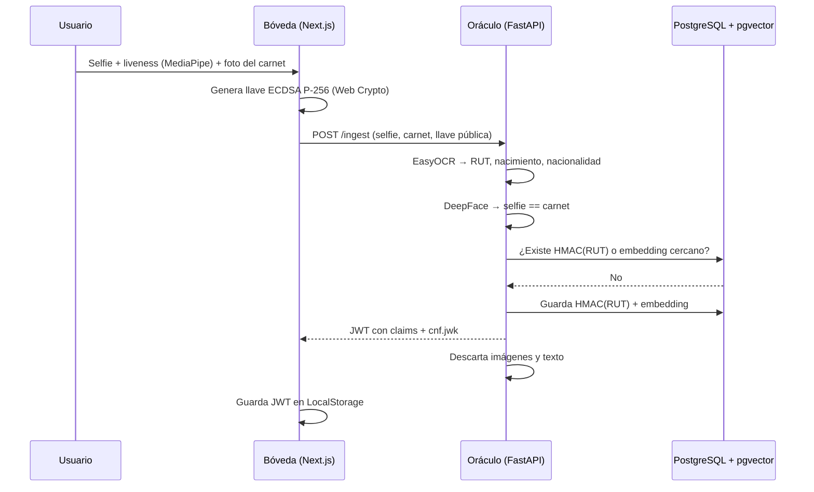
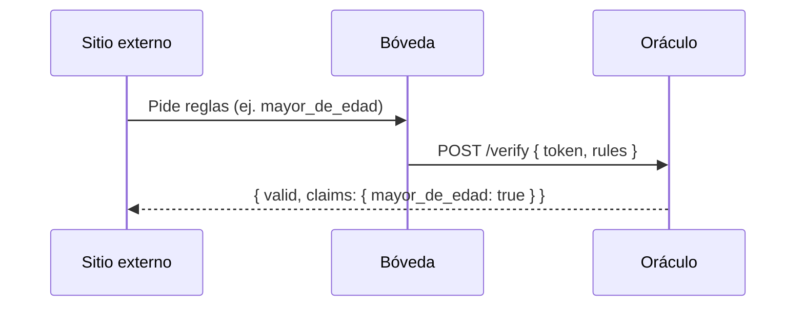

# Arquitectura — Retención Cero

## Flujo de emisión

## Flujo de verificación

## Decisiones

- **Imágenes solo en memoria.** Se decodifican con OpenCV desde los bytes del
  request; nunca se escriben a disco ni a la base de datos.
- **Unicidad sin identidad.** El RUT se guarda como HMAC-SHA256 con un pepper
  del servidor: permite detectar duplicados sin poder revertirlo. El embedding
  facial en pgvector detecta a la misma persona con otro documento.
- **Credencial en el dispositivo.** El JWT se liga a la llave pública del
  dispositivo (`cnf.jwk`), así queda preparada la prueba de posesión.
- **Divulgación mínima.** `/verify` solo responde las reglas que el sitio pidió.

## Despliegue

- `frontend/` → Vercel, con `frontend` como *Root Directory*.
- `backend/` → Render, usando `backend/Dockerfile` con `backend` como contexto.
- Ambos se conectan al repositorio personal espejo, porque Vercel y Render no
  pueden acceder al repo de la organización.
