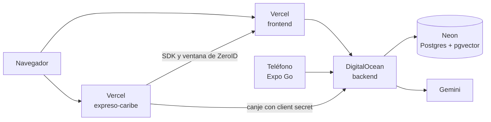

# Despliegue

Cómo está publicado ZeroID y cómo subir cambios a producción.

## Resumen

| Parte | Servicio | Cómo se actualiza |
|---|---|---|
| Web (`frontend/`) | Vercel, conectado al repo espejo de GitHub | Automático con cada `git push` a `main` |
| Demo Expreso Caribe (`expreso-caribe/`) | Vercel, otro proyecto sobre el mismo repo | Automático con cada `git push` a `main` |
| Backend (`backend/`) | DigitalOcean App Platform, desde una imagen Docker | Manual: construir y subir la imagen |
| Base de datos | Neon (Postgres 16 con pgvector) | Las tablas se crean o actualizan solas al arrancar el backend |
| App (`app/`) | Expo Go apuntando al backend de producción | Recargar Expo |



URL del backend: `https://octopus-app-h5zq3.ondigitalocean.app` (app `octopus-app` en DigitalOcean).

## Requisitos (una sola vez)

- **Git** con acceso al repo. `git push` publica en dos remotos a la vez: el repo de la organización y el espejo personal `daniperdomo/platanus-hack-14`, que es el que lee Vercel.
- **Docker Desktop** en ejecución.
- **doctl**, la herramienta de DigitalOcean:
  ```powershell
  winget install DigitalOcean.Doctl
  doctl auth init      # pide un token de API de DigitalOcean (Settings → API → Generate New Token)
  ```
  Si después de instalarlo la terminal no lo reconoce, abre una terminal nueva o recarga el PATH:
  ```powershell
  $env:Path = [Environment]::GetEnvironmentVariable("Path","Machine") + ";" + [Environment]::GetEnvironmentVariable("Path","User")
  ```
- Acceso a los proyectos de **Vercel**, **DigitalOcean** y **Neon**.

## Subir cambios

### 1. Guardar y subir el código

Antes de publicar, comprueba que todo compila:

```powershell
cd backend;  .\.venv\Scripts\python.exe -m pytest -m "not integration" -q;  cd ..
cd frontend; npx next build;  cd ..
cd app;      npx tsc --noEmit; cd ..
```

Luego:

```powershell
git status                      # revisa que no aparezcan .env, .pem ni secretos
git add <archivos>
git commit -m "tipo(área): descripción"
git push
```

Nunca hagas commit de archivos `.env`, `.env.local` ni llaves `.pem`. El `.gitignore` ya los excluye, pero revisa `git status` de todos modos.

### 2. Web (Vercel)

No hay que hacer nada: Vercel compila y publica solo cuando llega un push a `main`. Puedes seguir el progreso en la pestaña **Deployments** del proyecto.

Si cambiaste una variable de entorno en Vercel, haz **Redeploy** del último deploy. Las variables `NEXT_PUBLIC_*` se incrustan al compilar, así que no se aplican sin un build nuevo.

### 3. Backend (DigitalOcean)

Solo hace falta si cambiaste algo en `backend/`. Desde la raíz del repo:

```powershell
doctl registry login
docker build --platform linux/amd64 -t registry.digitalocean.com/zeroid/zeroid-api:latest backend
docker push registry.digitalocean.com/zeroid/zeroid-api:latest
```

- `--platform linux/amd64` es obligatorio: los servidores de DigitalOcean son amd64.
- `doctl registry login` dura 30 días; si `docker push` responde `unauthorized`, vuelve a ejecutarlo.

Si el componente tiene **Autodeploy** activado, DigitalOcean publica la imagen nueva solo. Si no, lanza el despliegue a mano:

```powershell
doctl apps list                                  # copia el ID de octopus-app
doctl apps create-deployment <ID>
```

Comprueba que arrancó:

```powershell
doctl apps list-deployments <ID>                 # la fase debe terminar en ACTIVE
curl https://octopus-app-h5zq3.ondigitalocean.app/health
```

`/health` debe responder `{"status":"ok"}`.

### 4. Base de datos

No hay migraciones manuales. Al arrancar, el backend ejecuta `init_db()`: crea la extensión `vector` y las tablas que falten con `CREATE TABLE IF NOT EXISTS`, usando la conexión directa (`DATABASE_URL_UNPOOLED`).

`CREATE TABLE IF NOT EXISTS` no modifica tablas que ya existen. Si un cambio agrega o cambia columnas, hay que aplicar el `ALTER TABLE` correspondiente en Neon (pestaña **SQL Editor**) o agregarlo a `init_db()` de forma idempotente (`ADD COLUMN IF NOT EXISTS`).

### 5. App

La app no se publica en tiendas. Para usarla contra producción, en `app/.env`:

```
EXPO_PUBLIC_API_URL=https://octopus-app-h5zq3.ondigitalocean.app
```

Y luego:

```powershell
cd app
npx expo start -c
```

`-c` limpia la caché; es necesario cada vez que cambias `.env`.

## Variables de entorno

Los valores reales no están en el repo. Se configuran en el panel de cada servicio.

### Backend (DigitalOcean → octopus-app → Settings → App-Level Environment Variables)

| Variable | Descripción | Cifrada |
|---|---|---|
| `DATABASE_URL` | Conexión a Neon **con** pooler (tráfico normal) | Sí |
| `DATABASE_URL_UNPOOLED` | Conexión directa a Neon (creación de tablas) | Sí |
| `JWT_PRIVATE_KEY` | Llave RSA en PEM, en una sola línea con `\n` | Sí |
| `HASH_PEPPER` | Secreto de 64 caracteres hexadecimales | Sí |
| `GEMINI_API_KEY` | Key de Gemini para leer pasaportes | Sí |
| `GEMINI_MODEL` | `gemini-3.8-flash` | No |
| `CORS_ORIGINS` | Dominios autorizados, separados por coma, sin `/` final. Ejemplo: `https://tu-proyecto.vercel.app,http://localhost:3000` | No |
| `DEBUG_PASSPORT` | `false` | No |

El backend **no arranca** si falta `JWT_PRIVATE_KEY`, si `HASH_PEPPER` tiene un valor de ejemplo o si falta `GEMINI_API_KEY`.

**No cambies `JWT_PRIVATE_KEY` ni `HASH_PEPPER` una vez que hay usuarios.** Con otra llave, todas las credenciales emitidas dejan de ser válidas. Con otro pepper, el sistema deja de detectar pasaportes duplicados y las llaves de los clientes del SDK dejan de funcionar.

Para pasar el PEM a una sola línea y copiarlo al portapapeles:

```powershell
(Get-Content "ruta\a\jwt_prod.pem") -join '\n' | Set-Clipboard
```

### Web (Vercel → Settings → Environment Variables, entorno Production)

| Variable | Descripción |
|---|---|
| `NEXT_PUBLIC_API_URL` | `https://octopus-app-h5zq3.ondigitalocean.app` |
| `NEXT_PUBLIC_DEMO_URL` | URL de la demo de Expreso Caribe; la usan los enlaces "Demo" y "Ver demo en vivo" |

Después de cambiarlas, haz **Redeploy**.

### Demo Expreso Caribe (Vercel → proyecto de `expreso-caribe` → Settings → Environment Variables)

| Variable | Descripción |
|---|---|
| `NEXT_PUBLIC_ZEROID_URL` | `https://platanus-hack-14.vercel.app`. De ahí carga el SDK y abre la ventana de inicio de sesión. |
| `ZEROID_API_URL` | `https://octopus-app-h5zq3.ondigitalocean.app`. Solo lo usa el servidor de la demo. |
| `NEXT_PUBLIC_ZEROID_CLIENT_ID` | ID del cliente de Expreso Caribe en producción |
| `ZEROID_CLIENT_SECRET` | Secreto de ese cliente. Solo lo usa el servidor de la demo (`/api/sesion`); no lleva `NEXT_PUBLIC_` para que no llegue al navegador. |

Después de cambiarlas, haz **Redeploy**.

## Tareas frecuentes

### Agregar un dominio nuevo para la web

1. Agrégalo en Vercel (**Settings → Domains**).
2. Agrégalo a `CORS_ORIGINS` en DigitalOcean. Sin esto, el navegador bloquea las llamadas al backend.
3. Si cambia el dominio de la demo de Expreso Caribe, registra un cliente nuevo con ese origen (siguiente sección). La demo no llama al backend desde el navegador, así que no necesita estar en `CORS_ORIGINS`.

### Registrar Expreso Caribe en producción

El script crea el cliente en la base a la que apunte `DATABASE_URL`. Como el secreto del cliente se guarda con un hash que usa `HASH_PEPPER`, hay que ejecutarlo con el **pepper de producción**; si no, el inicio de sesión de la demo falla.

Desde `backend/`, en PowerShell:

```powershell
$env:DATABASE_URL = "<DATABASE_URL de producción>"
$env:DATABASE_URL_UNPOOLED = "<DATABASE_URL_UNPOOLED de producción>"
$env:HASH_PEPPER = "<HASH_PEPPER de producción>"
.\.venv\Scripts\python.exe -m scripts.demo_client --origin https://<dominio-de-la-demo>.vercel.app
Remove-Item Env:DATABASE_URL, Env:DATABASE_URL_UNPOOLED, Env:HASH_PEPPER
```

El origen debe ser exactamente el dominio de la demo, sin `/` al final: la ventana de ZeroID rechaza clientes que la abren desde un origen no registrado.

El script escribe el ID y el secreto en `expreso-caribe/.env.local`. Cópialos a las variables `NEXT_PUBLIC_ZEROID_CLIENT_ID` y `ZEROID_CLIENT_SECRET` del proyecto de la demo en Vercel, y haz **Redeploy**.

Esto sobrescribe los valores locales de `expreso-caribe/.env.local`. Para volver a usar la demo en local, ejecuta `python -m scripts.demo_client` otra vez sin las variables de entorno.

### Vaciar la base de producción

```powershell
$env:DATABASE_URL = "<DATABASE_URL de producción>"
.\.venv\Scripts\python.exe -m scripts.reset_db --yes
Remove-Item Env:DATABASE_URL
```

Borra usuarios, cuentas, conexiones y solicitudes. Conserva las tablas y los clientes del SDK. No se puede deshacer.

### Ver los logs del backend

```powershell
doctl apps logs <ID> --type run --follow        # logs del servidor en vivo
doctl apps logs <ID> --type deploy              # logs del último despliegue
```

También están en el panel: **octopus-app → Runtime Logs**.

## Problemas comunes

| Síntoma | Causa | Solución |
|---|---|---|
| Deploy falla con `JWT_PRIVATE_KEY no está definida` | La variable está vacía en DigitalOcean | Pega la llave en una línea con `\n` |
| Deploy falla con `HASH_PEPPER mantiene un valor por defecto` | Se copió el valor de `.env.example` | Usa el pepper de producción |
| Deploy falla con `Readiness probe failed` | El servidor no arrancó; el error real está antes en el log | Revisa `doctl apps logs <ID> --type deploy` |
| El contenedor se reinicia al registrar a alguien | DeepFace se quedó sin memoria | Instancia de al menos 2 GB RAM |
| La web muestra errores de red o CORS en la consola | Falta el dominio en `CORS_ORIGINS` | Agrégalo en DigitalOcean, sin `/` final |
| La web sigue llamando a `localhost:8000` | Se cambió `NEXT_PUBLIC_API_URL` sin recompilar | **Redeploy** en Vercel |
| "Expreso Caribe no tiene configuradas sus credenciales de ZeroID" | Faltan las variables del cliente en el proyecto de la demo | Registra el cliente y cárgalas |
| La ventana de ZeroID dice que el sitio no está autorizado | El dominio de la demo no coincide con el origen registrado | Registra el cliente con `--origin` igual al dominio real |
| El primer registro tarda mucho | DeepFace descarga el modelo (~95 MB) la primera vez tras cada despliegue | Es esperable; los siguientes son rápidos |
| La cámara no abre en la web | El navegador exige HTTPS para usar la cámara | Usa el dominio de Vercel, no una IP |
